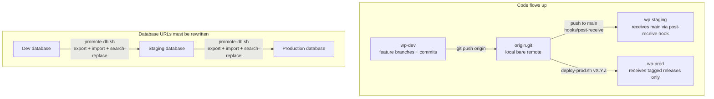

# wp-pipeline-poc

[](https://github.com/mhaiprojects/wp-pipeline-poc/actions/workflows/lint.yml)
[](https://github.com/mhaiprojects/wp-pipeline-poc/commits/main)

A local proof of concept for a **WordPress dev → staging → production**
pipeline, using three separate [DDEV](https://ddev.com/) sites and git.

The git history itself is the demonstration: a feature branch, a merge to
`main`, annotated tags `v0.1.0` and `v0.2.0`, and a verified production
rollback that redeployed `v0.1.0` without moving those tags.

Someone cloning this repository should be able to understand the entire
pipeline from this README alone. The full command log, port numbers, and
verification output from the original 19 November 2026 run are in
[docs/wp-pipeline-poc-2026-11-19.md](docs/wp-pipeline-poc-2026-11-19.md).
The rollback sequence is also summarised in
[docs/rollback.md](docs/rollback.md).

## Pipeline at a glance



**Code flows up. Data flows down.**

- Custom plugin code is committed on a feature branch in development,
  merged to `main` (which auto-deploys **staging**), and released to
  **production** only from an annotated tag.
- In a normal production workflow, databases flow the other way: a
  sanitized production dump is imported into staging or dev so developers
  debug against real content. `scripts/promote-db.sh` works in either
  direction. This PoC also ran it *upward* (dev → staging → prod) so
  URL rewriting could be demonstrated end to end.

Rollback of production is a code-only redeploy of an earlier tag. It
does not rewind the database.

## Repository layout

```
.
├── README.md
├── pipeline.ini.example                # copy to pipeline.ini (gitignored)
├── docs/
│   ├── wp-pipeline-poc-2026-11-19.md   # full write-up of the original run
│   └── rollback.md                     # verified prod rollback to v0.1.0
├── scripts/
│   ├── pipeline-common.sh              # config loader, PIPELINE_ROOT, URLs, helpers
│   ├── deploy-env.sh                   # deploy a git ref to staging or prod
│   ├── deploy-prod.sh                  # deploy a vX.Y.Z tag to production
│   ├── promote-db.sh                   # export, import, wp search-replace
│   ├── verify.sh                       # curl + wp-cli checks
│   └── post-receive                    # copy of the hook
├── hooks/post-receive                  # install into origin.git/hooks/
├── ddev/
│   ├── wp-dev/config.yaml              # sanitized sample (no dumps)
│   ├── wp-staging/config.yaml
│   └── wp-prod/config.yaml
├── wp-content/plugins/pipeline-demo/   # the marker plugin used to verify deploys
└── .github/workflows/
    ├── lint.yml                        # shellcheck + php -l (this one runs)
    └── deploy-illustrative.yml         # illustrative only; does not deploy
```

The original working tree tracked **only** the custom plugin. Later commits
on `main` added the docs, scripts, hook, sample DDEV configs, and this
README. WordPress core, uploads, live `.ddev/` generated files, database
dumps, and the three site directories are not in this repository.

If you use this clone as `PIPELINE_ROOT`, the local site trees
`wp-dev/`, `wp-staging/`, `wp-prod/`, plus `origin.git/`, `logs/`, and
`backups/`, are gitignored.

## The three environments

Each project is DDEV type `wordpress`, docroot `.`, PHP 8.4, MariaDB 11.8,
nginx-fpm, timezone `Australia/Melbourne`. WordPress 7.1.5 was used on the
original run (DDEV 1.25.2).

| Environment | DDEV project | Primary URL | How code arrives |
|---|---|---|---|
| Dev | `wp-dev` | https://wp-dev.ddev.site | Direct work on a feature branch; not a deploy target |
| Staging | `wp-staging` | https://wp-staging.ddev.site | Automatically, when `main` is pushed to the local bare remote |
| Production | `wp-prod` | https://wp-prod.ddev.site | Only via `scripts/deploy-prod.sh <tag>` |

Direct HTTP/HTTPS/Mailpit/DB ports are assigned by DDEV and change between
machines. On the original host they were recorded in
[the write-up](docs/wp-pipeline-poc-2026-11-19.md). Use `ddev describe <name>`
for current ports. Mailpit per site is at `https://wp-*.ddev.site:8026`.

### Create the three sites from scratch

Set a password in `WP_ADMIN_PASS` first. Do not commit it, and do not
reuse a production password.

```bash
export WP_ADMIN_PASS  # set this in your shell; choose your own password
export PIPELINE_ROOT="$PWD"   # if this clone is the pipeline root

# ddev start shares a router, so start the three projects sequentially.
for env in dev staging prod; do
  name="wp-$env"
  mkdir -p "$PIPELINE_ROOT/$name"
  cd "$PIPELINE_ROOT/$name"
  ddev config --project-type=wordpress --docroot=. --project-name="$name" \
    --php-version=8.4 --database=mariadb:11.8 --timezone=Australia/Melbourne --auto
  ddev start
  ddev wp core download --force
  title="WP Pipeline $(echo "$env" | sed 's/./\U&/')"
  ddev wp core install \
    --url="https://${name}.ddev.site" \
    --title="$title" \
    --admin_user=admin \
    --admin_password="${WP_ADMIN_PASS:?Set WP_ADMIN_PASS to a password of your choosing}" \
    --admin_email="admin@${name}.ddev.site" \
    --skip-email
  ddev wp core is-installed
  ddev wp option get siteurl
  curl -sk -o /dev/null -w "HTTP %{http_code}\n" "https://${name}.ddev.site/"
done
```

Sample sanitized configs (no generated Compose files, no database dumps)
live under [`ddev/`](ddev/). Copying `ddev/<name>/config.yaml` to
`<name>/.ddev/config.yaml` is equivalent to the `ddev config` line above;
running `ddev config` is the preferred path.

Do not run `ddev stop --all` if other DDEV projects share the machine.
Start or stop only these three:

```bash
cd "$PIPELINE_ROOT/wp-dev" && ddev start     # or ddev stop
cd "$PIPELINE_ROOT/wp-staging" && ddev start
cd "$PIPELINE_ROOT/wp-prod" && ddev start
```

## Configuration

The scripts in `scripts/` load optional local settings from `pipeline.ini`
so you can point the pipeline at different directories, URLs, or (later)
remote hosts without editing the scripts. Copy the tracked example and
edit the copy:

```bash
cp pipeline.ini.example pipeline.ini
# edit pipeline.ini — fill in paths and URLs for your machine
```

`pipeline.ini` is gitignored. Never commit real passwords, SSH hosts with
credentials, or database dumps. The example uses placeholders such as
`changeme`.

### Where the file is read

`scripts/pipeline-common.sh` looks for:

1. The file named by `$PIPELINE_CONFIG`, if you set that environment
   variable to a path, otherwise
2. `$PIPELINE_ROOT/pipeline.ini` (the repository root, when
   `PIPELINE_ROOT` is unset)

If that file is missing and you did not set `PIPELINE_CONFIG`, the
scripts also accept a `.env` file in the same directory, using
`KEY=VALUE` lines (for example `STAGING_URL=https://...`). `.env` is
gitignored too.

If neither file is present, built-in defaults are used — the same paths
and `https://wp-<env>.ddev.site` URLs this PoC originally ran with.

### Precedence

1. Environment variables already set in your shell (for example
   `export STAGING_URL=...`). An empty-but-set variable still wins.
2. Values in `pipeline.ini` (or `.env`)
3. Built-in defaults in `pipeline-common.sh`

### Format

`pipeline.ini` is a simple INI file. Values are assigned literally; they
are not executed as shell and are not expanded (`$HOME` is not
substituted). Leave a key blank, or omit it, to keep the built-in
default.

| Section / key | Variable | Built-in default |
|---|---|---|
| `[pipeline] root` | `PIPELINE_ROOT` | directory containing `scripts/` |
| `[pipeline] bare` | `PIPELINE_BARE` | `$PIPELINE_ROOT/origin.git` |
| `[pipeline] log_dir` | `PIPELINE_LOG_DIR` | `$PIPELINE_ROOT/logs` |
| `[pipeline] backup_dir` | `PIPELINE_BACKUP_DIR` | `$PIPELINE_ROOT/backups` |
| `[pipeline] admin_user` | `WP_ADMIN_USER` | (empty) |
| `[pipeline] admin_password` | `WP_ADMIN_PASS` | (empty) |
| `[pipeline] admin_email` | `WP_ADMIN_EMAIL` | (empty) |
| `[dev] path` | `DEV_PATH` | `$PIPELINE_ROOT/wp-dev` |
| `[dev] url` | `DEV_URL` | `https://wp-dev.ddev.site` |
| `[dev] db_name` | `DEV_DB_NAME` | (empty) |
| `[dev] db_user` | `DEV_DB_USER` | (empty) |
| `[dev] db_password` | `DEV_DB_PASSWORD` | (empty) |
| `[dev] db_host` | `DEV_DB_HOST` | (empty) |
| `[dev] ssh_host` | `DEV_SSH_HOST` | (empty) |
| `[dev] ssh_user` | `DEV_SSH_USER` | (empty) |
| `[dev] deploy_path` | `DEV_DEPLOY_PATH` | (empty) |
| `[staging] path` | `STAGING_PATH` | `$PIPELINE_ROOT/wp-staging` |
| `[staging] url` | `STAGING_URL` | `https://wp-staging.ddev.site` |
| `[staging] db_*` / `ssh_*` / `deploy_path` | `STAGING_DB_*`, `STAGING_SSH_*`, `STAGING_DEPLOY_PATH` | (empty) |
| `[prod] path` | `PROD_PATH` | `$PIPELINE_ROOT/wp-prod` |
| `[prod] url` | `PROD_URL` | `https://wp-prod.ddev.site` |
| `[prod] db_*` / `ssh_*` / `deploy_path` | `PROD_DB_*`, `PROD_SSH_*`, `PROD_DEPLOY_PATH` | (empty) |

A `.env` file uses the variable names in the second column directly:

```
STAGING_URL=https://staging.example.com
PIPELINE_LOG_DIR=/var/log/wp-pipeline
```

Database, SSH, deploy-path, and `admin_*` keys are placeholders for a
non-DDEV or remote setup. The current deploy, promote, and verify
scripts talk to local DDEV projects and do not use those keys yet.

## Code flow

### 1. Feature branch in dev

Work on `wp-content/plugins/pipeline-demo` (or your own plugin). Commit
with a timestamp-first message and push the feature branch to the local
bare remote. The hook **skips** non-`main` refs, so staging stays unchanged.

```bash
git checkout -b feature/add-pipeline-demo
# edit the plugin, commit
git push origin feature/add-pipeline-demo
# hook log: "skipping non-main ref refs/heads/feature/add-pipeline-demo"
```

On the original run this produced commit `b6c835c` and a visible
`PIPELINE_DEMO v0.1.0` banner on https://wp-dev.ddev.site only.

### 2. Merge to `main` auto-deploys staging

```bash
git checkout main
git merge --no-ff feature/add-pipeline-demo \
  -m "$(date '+%Y-%m-%d %H:%M') AEDT: Merge feature/add-pipeline-demo into main (v0.1.0)"
git push origin main
```

`hooks/post-receive` sees `refs/heads/main` and runs
`scripts/deploy-env.sh staging main`. That script uses `git archive` plus
`rsync --delete` into `wp-staging/wp-content/plugins/pipeline-demo/`,
activates the plugin, and flushes the cache. It does **not** run
`git checkout` against the bare repo, so the bare `HEAD` is not moved
and a later production deploy cannot clobber staging.

Verified on the original run: staging showed
`PIPELINE_DEMO v0.1.0 (plugin 0.1.0) on https://wp-staging.ddev.site`.

### 3. Tag a release; production does not follow `main`

```bash
git tag -a v0.1.0 -m "$(date '+%Y-%m-%d %H:%M') AEDT: Release v0.1.0 of pipeline-demo"
git push origin v0.1.0
# hook: "skipping non-main ref refs/tags/v0.1.0"
```

Pushing a tag does **not** deploy production. Production receives code
only from an explicit tag deploy:

```bash
scripts/deploy-prod.sh v0.1.0
scripts/verify.sh prod v0.1.0
```

`deploy-prod.sh` refuses anything that does not look like `vX.Y.Z`, then
calls `deploy-env.sh prod <tag>`.

The same pattern was repeated for `v0.2.0`. After `v0.2.0` was merged to
`main`, staging moved to v0.2.0 and **production stayed on v0.1.0** until
`scripts/deploy-prod.sh v0.2.0` was run.

## How rollback works

Redeploy the previous tag. Do not delete, move, or retarget existing tags.

```bash
# After production has been on v0.2.0:
scripts/deploy-prod.sh v0.1.0
scripts/verify.sh prod v0.1.0
scripts/verify.sh staging v0.2.0
```

Verified result (10:01 AEDT, Australia/Sydney, 19 November 2026):

- Production returned to `PIPELINE_DEMO v0.1.0` (no "wave 2 banner").
- Unique promoted page content was still present (the database was not
  rolled back).
- Staging remained on v0.2.0.
- The on-disk production tag file returned to `v0.1.0`.

See [docs/rollback.md](docs/rollback.md). To move production forward
again: `scripts/deploy-prod.sh v0.2.0`.

## Database promotion and URL migration

```bash
scripts/promote-db.sh dev staging
scripts/promote-db.sh staging prod
# Typical "data flows down" example:
# scripts/promote-db.sh prod staging
```

Each run:

1. Backs up the destination database, then exports the source
   (`ddev export-db --gzip=true`).
2. Imports the source dump into the destination (`ddev import-db`).
3. Runs `ddev wp search-replace <from-url> <to-url> --all-tables --dry-run`
   for the HTTPS site URL, then for the HTTP variant.
4. Repeats those replacements without `--dry-run`.
5. Flushes rewrites and cache, re-activates `pipeline-demo`, and restores
   `pipeline_deployed_ref` / `pipeline_deployed_sha` from on-disk files
   (a database import overwrites options).

**Counts seen on the original run** (dev → staging, then staging → prod):

| Replacement | Count |
|---|---|
| HTTPS (`https://wp-dev.ddev.site` → `https://wp-staging.ddev.site`, and the same pattern for staging → prod) | **10** live replacements, matching the dry-run |
| of which `wp_options.option_value` (PHP serialized, including `siteurl` / `home`) | 2 |
| of which `wp_posts.post_content` | 2 |
| of which `wp_posts.guid` | 5 |
| of which `wp_users.user_url` | 1 |
| HTTP (`http://wp-…`) | **0** (sites were installed with HTTPS) |

After each hop, the unique page appeared at the **destination** URL only,
with no leftover source hostnames. Always inspect the dry-run counts
before the live replacement.

A reminder: promoting a whole database also copies values such as the
site title. In a real workflow, keep environment-specific options
afterwards, or treat upward promotion as unusual and let **data flow
down** from production instead.

## Quick start (clone this repo and recreate the pipeline)

Prerequisites: Docker, DDEV, git, rsync, and curl. WP-CLI is provided by
`ddev wp`.

```bash
git clone https://github.com/mhaiprojects/wp-pipeline-poc.git
cd wp-pipeline-poc
export PIPELINE_ROOT="$PWD"
export WP_ADMIN_PASS  # set your own password; do not commit it
cp pipeline.ini.example pipeline.ini   # optional; edit if your paths or URLs differ
```

1. **Create a local bare remote** so the post-receive hook can run.
   (Pushing to GitHub does not run this hook.)

   ```bash
   git init --bare --initial-branch=main origin.git
   cp hooks/post-receive origin.git/hooks/post-receive
   chmod +x origin.git/hooks/post-receive
   git remote add local-bare "$PIPELINE_ROOT/origin.git"
   git push local-bare --all
   git push local-bare --tags
   ```

2. **Create the three DDEV sites** with the commands in
   [Create the three sites from scratch](#create-the-three-sites-from-scratch).

3. **Put the plugin on the dev site** so you can see the banner while
   you work (the git copy already lives in this checkout):

   ```bash
   mkdir -p "$PIPELINE_ROOT/wp-dev/wp-content/plugins"
   ln -sfn "$PIPELINE_ROOT/wp-content/plugins/pipeline-demo" \
     "$PIPELINE_ROOT/wp-dev/wp-content/plugins/pipeline-demo"
   cd "$PIPELINE_ROOT/wp-dev"
   ddev wp plugin activate pipeline-demo
   ```

4. **Exercise the flow:** make a change on a feature branch, merge to
   `main`, `git push local-bare main` (staging updates), tag a release,
   then `scripts/deploy-prod.sh vX.Y.Z`. Roll back with an earlier tag.

5. **Promote a database** only after you have content worth copying, and
   always read the dry-run output first.

## Verification commands

```bash
scripts/verify.sh all
scripts/verify.sh staging v0.2.0
scripts/verify.sh prod v0.1.0
```

`verify.sh` curls the site homepage, looks for a `PIPELINE_DEMO` marker,
optionally checks a release string, and prints the plugin list, `siteurl`,
and the on-disk deployed ref/tag files.

You can also confirm by hand:

```bash
curl -sk https://wp-staging.ddev.site/ | grep -o 'PIPELINE_DEMO[^<]*'
curl -sk https://wp-prod.ddev.site/    | grep -o 'PIPELINE_DEMO[^<]*'
```

## Git history of this demonstration

```
*   376e954 (tag: v0.2.0) Merge feature/v0.2.0-marker into main
|\
| * c90bd09 (feature/v0.2.0-marker) Bump pipeline-demo to v0.2.0 with wave 2 banner
|/
*   033baf2 (tag: v0.1.0) Merge feature/add-pipeline-demo into main (v0.1.0)
|\
| * b6c835c (feature/add-pipeline-demo) Add pipeline-demo plugin v0.1.0
|/
* 3c0008f Initialize wp-pipeline repo with plugin-only gitignore
```

Later commits on `main` add the showcase docs and scripts; they do not
move `v0.1.0` or `v0.2.0`.

| Tag | Commit | Notes |
|---|---|---|
| `v0.1.0` | `033baf2` | First release |
| `v0.2.0` | `376e954` | Wave 2 banner |

## Known issues

These were encountered on the original run and are documented more fully
in the [write-up](docs/wp-pipeline-poc-2026-11-19.md):

1. **Parallel `ddev config` vs `ddev list`.** Newly configured projects
   may not appear in `ddev list` until the first `ddev start`. Harmless.
2. **Shared DDEV router.** Start the three projects sequentially. Starting
   one can recreate `ddev-router` briefly.
3. **`GIT_DIR` in the hook environment.** Git sets `GIT_DIR` for hook
   processes. The hook runs the deploy script with
   `env -u GIT_DIR -u GIT_WORK_TREE -u GIT_INDEX_FILE`, and `deploy-env.sh`
   also unsets them.
4. **SIGPIPE (exit 141) with `curl | grep | head` under `pipefail`.**
   `head` can close the pipe early. Prefer `verify.sh` or avoid `head`.
5. **Database import overwrites options.** `promote-db.sh` restores
   deploy metadata from on-disk `.pipeline-deployed-*` files and
   re-activates the plugin.
6. **Site title followed the source database.** After upward promotion,
   staging and production inherited "WP Pipeline Dev". Expected when you
   import the whole database. Prefer data flowing down, or fix titles
   afterwards with `ddev wp option update blogname ...`.
7. **Privacy Policy permalink** can stay as `?page_id=3`. Not a pipeline bug.
8. **nginx `.htaccess` warning** from `ddev wp rewrite structure` on
   nginx-fpm. Rules still flushed.
9. **DDEV upgrade notice.** The original host was on DDEV 1.25.2 and was
   not upgraded for this PoC.

## Scripts reference

| Script | Purpose |
|---|---|
| `scripts/deploy-env.sh <staging\|prod> <ref>` | Deploy a git ref into staging or prod |
| `scripts/deploy-prod.sh <tag>` | Deploy a `vX.Y.Z` tag into production |
| `scripts/promote-db.sh <from> <to>` | Export, import, dry-run then live `wp search-replace --all-tables` |
| `scripts/verify.sh [env\|all] [expected-release]` | Confirm banners and plugin state |
| `hooks/post-receive` | Auto-deploy `main` to staging |

Override paths and URLs with `pipeline.ini` (see
[Configuration](#configuration)), or with environment variables such as
`PIPELINE_ROOT`, `PIPELINE_BARE`, `PIPELINE_LOG_DIR`,
`PIPELINE_BACKUP_DIR`, `DEV_PATH`, `STAGING_PATH`, `PROD_PATH`,
`DEV_URL`, `STAGING_URL`, and `PROD_URL`. Environment variables win
over the config file, which wins over the built-in defaults. By default
`PIPELINE_ROOT` is the directory that contains `scripts/` (this
repository root).

## What is not in this repository

- No secrets, API keys, credentials, or database dumps.
- No WordPress core, `wp-config.php`, or live DDEV generated files.
- The original local sites on the development host were not modified
  when this public repository was published, and they are not deployed
  from GitHub Actions. The "Deploy (illustrative)" workflow is labelled
  as such and performs no deploy.
