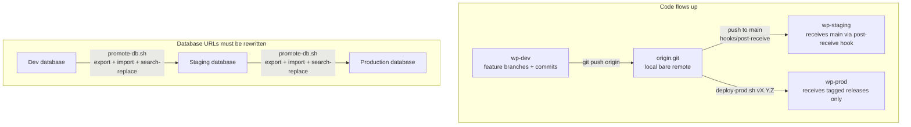

# WordPress DDEV Dev → Staging → Production Pipeline PoC

> **Published copy.** This is an adapted write-up of the local proof of concept
> run on 19 November 2026. Absolute paths such as
> `/home/systemadmin/_WS/DevWS/wp-pipeline` describe that original host layout.
> In this public repository, set `PIPELINE_ROOT` to your own directory (by
> default, the root of this clone). Admin passwords are not recorded here;
> set `WP_ADMIN_PASS` to a password of your choosing when you install WordPress.
> The original local bare remote was not a GitHub remote; this repository was
> published afterwards as a history and documentation showcase.

**Date:** 19 November 2026 (Australia/Sydney, AEDT, UTC+11)  
**Host:** buspc (`systemadmin`, Manjaro)  
**DDEV:** v1.25.2 (an upgrade notice for v1.25.5 was shown and ignored)  
**WordPress:** 7.1.5 on PHP 8.4 / MariaDB 11.8 / nginx-fpm  
**GitHub:** the original run used a local bare repo only. This public repository was created afterwards as a showcase of that history and documentation.

This proof of concept creates three separate DDEV WordPress sites and a local git workflow that deploys custom plugin code **up** (dev → staging on merge to `main`, production only from a tag) and demonstrates database URL rewriting between environments.

The scripts live in two places (identical copies):

- `/home/systemadmin/_WS/DevWS/wp-pipeline/scripts/`
- `/home/systemadmin/grok-bot-files/wp-pipeline/scripts/`

---

## Overview



In a normal production workflow, **code flows up** and **databases flow down** (a sanitized prod dump is imported into staging or dev so developers debug against real content). This PoC still implements upward content promotion so URL search-replace could be demonstrated end to end. `promote-db.sh` works in either direction.

Rollback of production is a code-only redeploy of an earlier tag. It does not rewind the database.

---

## Projects, URLs, and ports

Global DDEV router (shared, already running for inhospitality):

| Service | Host port |
|---|---|
| Router HTTP | 80 |
| Router HTTPS | 443 |
| Mailpit HTTP / HTTPS | 8025 / 8026 |
| XHGui HTTP / HTTPS | 8143 / 8142 |
| Traefik monitor | 10999 |

Each new project is type `wordpress`, docroot `.`, timezone `Australia/Melbourne`.

| Environment | Project name | Path | Primary URL | Direct web ports (HTTP / HTTPS / Mailpit) | Direct DB port |
|---|---|---|---|---|---|
| Dev | `wp-dev` | `/home/systemadmin/_WS/DevWS/wp-pipeline/wp-dev` | https://wp-dev.ddev.site | 127.0.0.1:32780 / 32781 / 32782 | 127.0.0.1:32779 |
| Staging | `wp-staging` | `/home/systemadmin/_WS/DevWS/wp-pipeline/wp-staging` | https://wp-staging.ddev.site | 127.0.0.1:32787 / 32788 / 32789 | 127.0.0.1:32783 |
| Production | `wp-prod` | `/home/systemadmin/_WS/DevWS/wp-pipeline/wp-prod` | https://wp-prod.ddev.site | 127.0.0.1:32791 / 32792 / 32793 | 127.0.0.1:32794 |

Alternate URLs from `ddev describe` also include `http://wp-*.ddev.site` and the direct `127.0.0.1` ports above. Mailpit per site is at `https://wp-*.ddev.site:8026`.

Local-only admin on all three installs: username `admin`, password from the `WP_ADMIN_PASS` environment variable (choose your own and do not commit it), email `admin@wp-<env>.ddev.site`.

Existing DDEV projects were left alone and kept their previous status: **inhospitality** stayed running (HTTP 200 after this work), **wp-fresh** / **cursor-wpdev2** / **wpdev3-rootsio** stayed paused, **cursor-aio-web** stayed stopped.

---

## Directory layout

```
/home/systemadmin/_WS/DevWS/wp-pipeline/
  origin.git/                 # local bare remote (no GitHub)
    hooks/post-receive        # deploys main -> wp-staging
  scripts/                    # deploy, promote, verify
  logs/                       # hook and deploy logs
  backups/                    # gzipped DB dumps from promote-db.sh
  wp-dev/                     # development site + git working tree
    .git/
    .gitignore                # tracks only wp-content/plugins/pipeline-demo
    wp-content/plugins/pipeline-demo/
  wp-staging/
  wp-prod/
  README.md                   # points at this document
```

The git repo tracks **only** the custom plugin (and `.gitignore`). WordPress core, uploads, `.ddev/`, `wp-config.php`, and other themes/plugins stay untracked.

```gitignore
# wp-pipeline PoC: track only custom plugin code.
# WordPress core, uploads, DDEV config, and other plugins/themes stay untracked.
/*
!/.gitignore
!/wp-content/
/wp-content/*
!/wp-content/plugins/
/wp-content/plugins/*
!/wp-content/plugins/pipeline-demo/
!/wp-content/plugins/pipeline-demo/**
```


---

## What was tested, and the results

| Step | Result |
|---|---|
| Three fresh WordPress installs via `ddev config` + `ddev start` + `ddev wp core download/install` | All three returned HTTP 200 at their `https://wp-*.ddev.site` URLs. WordPress 7.1.5. |
| Feature branch with `pipeline-demo` v0.1.0 pushed to `origin.git` | post-receive **skipped** the feature branch; staging was unchanged. |
| Plugin activated on dev; unique page `pipeline-poc-page` created | Homepage curl showed `PIPELINE_DEMO v0.1.0 ... on https://wp-dev.ddev.site`. Page contained `PIPELINE_POC_PAGE_DEV_2026-11-19`. |
| Merge to `main` and `git push origin main` | Hook deployed `main` (`033baf2`) into wp-staging, activated the plugin, flushed cache. Staging curl showed `PIPELINE_DEMO v0.1.0 ... on https://wp-staging.ddev.site`. `wp plugin list` showed `pipeline-demo active 0.1.0`. |
| Tag `v0.1.0` pushed | Hook skipped the tag (production is not auto-deployed). |
| `deploy-prod.sh v0.1.0` | Prod curl showed `PIPELINE_DEMO v0.1.0 ... on https://wp-prod.ddev.site`. On-disk tag file and `pipeline_deployed_ref` option both recorded `v0.1.0`. |
| `promote-db.sh dev staging` then `staging prod` | Dry-run then live search-replace. Unique page appeared on staging and prod with the **destination** URL only (no leftover `wp-dev` / `wp-staging` hosts). 10 HTTPS replacements per hop; 0 HTTP replacements (sites were installed with HTTPS). |
| v0.2.0 feature branch (maroon "wave 2 banner") merged to main | Staging moved to v0.2.0. **Prod stayed on v0.1.0** until an explicit tag deploy. |
| Tag `v0.2.0` + `deploy-prod.sh v0.2.0` | Prod showed `PIPELINE_DEMO v0.2.0 ... — wave 2 banner`. Promoted page content was still present. |
| Rollback: `deploy-prod.sh v0.1.0` | Prod banner returned to v0.1.0 (no "wave 2" text). Unique promoted content remained. Staging stayed on v0.2.0. |

Final state after the rollback demonstration:

| Environment | Code on the page | Deployed ref / tag file |
|---|---|---|
| Dev | v0.2.0 wave 2 banner | (not a deploy target) |
| Staging | v0.2.0 wave 2 banner | `main` (`376e954`) |
| Production | v0.1.0 (rolled back) | `v0.1.0` (`033baf2`) |

---

## Tags and git history

Code remote: `/home/systemadmin/_WS/DevWS/wp-pipeline/origin.git`  
Working tree: `/home/systemadmin/_WS/DevWS/wp-pipeline/wp-dev`  
Commit identity: `mhaiprojects <150572495+mhaiprojects@users.noreply.github.com>`  
The only remotes are this local path. No GitHub remote was added.

| Tag | Annotated tag object | Commit | Message |
|---|---|---|---|
| `v0.1.0` | `a5dccea7bbc5f6b429a32117521c39d709285728` | `033baf2dffd5dae2a06c5a7ed375d23c535c3468` | `2026-11-19 09:58 AEDT: Release v0.1.0 of pipeline-demo` |
| `v0.2.0` | `fffdf4afd302786aac389ea90cb1ecc172bbb800` | `376e954ca32e335417a7062e4c2dfc1442423204` | `2026-11-19 10:01 AEDT: Release v0.2.0 of pipeline-demo` |

```
*   376e954 (main, tag: v0.2.0) 2026-11-19 10:00 AEDT: Merge feature/v0.2.0-marker into main
|\
| * c90bd09 (feature/v0.2.0-marker) 2026-11-19 10:00 AEDT: Bump pipeline-demo to v0.2.0 with wave 2 banner
|/
*   033baf2 (tag: v0.1.0) 2026-11-19 09:58 AEDT: Merge feature/add-pipeline-demo into main (v0.1.0)
|\
| * b6c835c (feature/add-pipeline-demo) 2026-11-19 09:58 AEDT: Add pipeline-demo plugin v0.1.0 with visible page marker
|/
* 3c0008f 2026-11-19 09:58 AEDT: Initialize wp-pipeline repo with plugin-only gitignore
```

---

## Commands used

### 1. Check for name/port clashes (read-only)

```bash
ddev list
ddev version
ddev describe inhospitality
# Existing names: cursor-aio-web, cursor-wpdev2, inhospitality, wp-fresh, wpdev3-rootsio.
# No wp-dev / wp-staging / wp-prod. Router already on 80/443.
```

### 2. Create and start the three sites

`ddev config` was run in parallel for the three project directories. `ddev start` was run sequentially (they share `ddev-router`). WordPress core download and install were then run in parallel.

```bash
BASE=/home/systemadmin/_WS/DevWS/wp-pipeline
mkdir -p "$BASE"/{wp-dev,wp-staging,wp-prod,scripts,logs,backups}

# Per project (names wp-dev, wp-staging, wp-prod):
cd "$BASE/<name>"
ddev config --project-type=wordpress --docroot=. --project-name=<name> \
  --php-version=8.4 --database=mariadb:11.8 --timezone=Australia/Melbourne --auto
ddev start

ddev wp core download --force
ddev wp core install \
  --url=https://<name>.ddev.site \
  --title="WP Pipeline <Dev|Staging|Production>" \
  --admin_user=admin --admin_password="${WP_ADMIN_PASS:?Set WP_ADMIN_PASS to a password of your choosing}" \
  --admin_email=admin@<name>.ddev.site --skip-email

ddev wp core is-installed
ddev wp option get siteurl
curl -sk -o /dev/null -w "HTTP %{http_code}\n" https://<name>.ddev.site/
ddev describe <name>
```

Install verification (19 Nov 2026, 09:55 AEDT):

- wp-dev: `Success: WordPress installed successfully.` siteurl `https://wp-dev.ddev.site` HTTP 200
- wp-staging: same, title "WP Pipeline Staging", HTTP 200
- wp-prod: same, title "WP Pipeline Production", HTTP 200

### 3. Initialise the local bare remote and the dev working tree

The post-receive hook was **not** installed until after the first `main` push (`.gitignore` only), so a plugin-less `main` would not trigger a failed deploy.

```bash
rm -rf "$BASE/origin.git"
git init --bare --initial-branch=main "$BASE/origin.git"
git --git-dir="$BASE/origin.git" symbolic-ref HEAD refs/heads/main

cd "$BASE/wp-dev"
git init --initial-branch=main
git config user.name "mhaiprojects"
git config user.email "150572495+mhaiprojects@users.noreply.github.com"
git remote add origin "$BASE/origin.git"
git add .gitignore
git commit -m "$(date '+%Y-%m-%d %H:%M') AEDT: Initialize wp-pipeline repo with plugin-only gitignore"
git push -u origin main

cp "$BASE/scripts/post-receive" "$BASE/origin.git/hooks/post-receive"
chmod +x "$BASE/origin.git/hooks/post-receive"
```

Root commit: `3c0008f`.

### 4. Feature branch, activate on dev, unique content

```bash
git checkout -b feature/add-pipeline-demo
git add wp-content/plugins/pipeline-demo
git commit -m "$(date '+%Y-%m-%d %H:%M') AEDT: Add pipeline-demo plugin v0.1.0 with visible page marker"
git push -u origin feature/add-pipeline-demo
# Hook log: "skipping non-main ref refs/heads/feature/add-pipeline-demo"

ddev wp plugin activate pipeline-demo
ddev wp post create --post_type=page --post_title='Pipeline PoC Page' \
  --post_name='pipeline-poc-page' --post_status=publish \
  --post_content='Unique dev content marker PIPELINE_POC_PAGE_DEV_2026-11-19. ... [pipeline_demo]' \
  --porcelain
# PAGE_ID=5, URL https://wp-dev.ddev.site/pipeline-poc-page/
ddev wp option update blogdescription "Inhospitality-style pipeline PoC — content originated on wp-dev"
ddev wp rewrite structure '/%postname%/' --hard

curl -sk https://wp-dev.ddev.site/ | grep -o 'PIPELINE_DEMO[^<]*'
# PIPELINE_DEMO v0.1.0 (plugin 0.1.0) on https://wp-dev.ddev.site
```

`ddev wp rewrite structure` printed a `.htaccess` warning (these sites use nginx, not Apache). Rewrite rules were still flushed successfully.

### 5. Merge to main → automatic staging deploy

```bash
git checkout main
git merge --no-ff feature/add-pipeline-demo \
  -m "$(date '+%Y-%m-%d %H:%M') AEDT: Merge feature/add-pipeline-demo into main (v0.1.0)"
git push origin main
# Hook: main 3c0008f -> 033baf2; deploy-env.sh staging main
# plugin activated, cache flushed, pipeline-demo 0.1.0 active

./scripts/verify.sh staging v0.1.0
# HTTP 200
# Marker: PIPELINE_DEMO v0.1.0 (plugin 0.1.0) on https://wp-staging.ddev.site
# Expected release v0.1.0: OK
```

The hook deploys with `git archive` + `rsync --delete` into `wp-staging/wp-content/plugins/pipeline-demo/`. It does **not** run `git checkout` against the bare repo, so the bare `HEAD` is not moved and a later production deploy cannot clobber the staging files.

### 6. Tag v0.1.0 and deploy production

```bash
git tag -a v0.1.0 -m "$(date '+%Y-%m-%d %H:%M') AEDT: Release v0.1.0 of pipeline-demo"
git push origin v0.1.0
# Hook: "skipping non-main ref refs/tags/v0.1.0"

"$BASE/scripts/deploy-prod.sh" v0.1.0
"$BASE/scripts/verify.sh" prod v0.1.0
# Marker: PIPELINE_DEMO v0.1.0 (plugin 0.1.0) on https://wp-prod.ddev.site
# Deployed tag file: v0.1.0
```

### 7. Database promotion and URL search-replace

```bash
"$BASE/scripts/promote-db.sh" dev staging
"$BASE/scripts/promote-db.sh" staging prod
```

Each run:

1. `ddev export-db --gzip=true` of the destination (backup) and of the source.
2. `ddev import-db --file=...` into the destination.
3. `ddev wp search-replace <from-url> <to-url> --all-tables --dry-run` for HTTPS, then HTTP.
4. The same replacements without `--dry-run`.
5. `ddev wp rewrite flush` and `ddev wp cache flush`.
6. Re-activate `pipeline-demo` and restore `pipeline_deployed_ref` / `pipeline_deployed_sha` from the on-disk files (a DB import overwrites options).

**dev → staging** (09:59 AEDT), replace `https://wp-dev.ddev.site` → `https://wp-staging.ddev.site`:

| Table.column | Replacements | Type |
|---|---|---|
| `wp_options.option_value` | 2 | PHP (serialized; includes `siteurl` / `home`) |
| `wp_posts.post_content` | 2 | SQL |
| `wp_posts.guid` | 5 | SQL |
| `wp_users.user_url` | 1 | SQL |
| **Total HTTPS** | **10** | dry-run matched live |
| HTTP (`http://wp-dev...`) | **0** | sites were installed with HTTPS |

After promotion, staging `siteurl` / `home` were `https://wp-staging.ddev.site`. The unique page was at `https://wp-staging.ddev.site/pipeline-poc-page/`, contained `PIPELINE_POC_PAGE_DEV_2026-11-19`, and had **no** leftover `wp-dev.ddev.site` URLs. The site title became "WP Pipeline Dev" because that value came from the source database (see Issues).

**staging → prod** (09:59–10:00 AEDT), replace `https://wp-staging.ddev.site` → `https://wp-prod.ddev.site`: the same 10 / 0 counts. Prod page `https://wp-prod.ddev.site/pipeline-poc-page/` contained the unique marker, used only prod URLs, and still showed the v0.1.0 plugin banner. Dumps are in `$BASE/backups/*.sql.gz`.

### 8. v0.2.0, production deploy, and rollback

```bash
git checkout -b feature/v0.2.0-marker
# Version 0.2.0, maroon banner, extra "wave 2 banner" wording
git commit -m "$(date '+%Y-%m-%d %H:%M') AEDT: Bump pipeline-demo to v0.2.0 with wave 2 banner"
git push -u origin feature/v0.2.0-marker   # hook skipped

git checkout main
git merge --no-ff feature/v0.2.0-marker \
  -m "$(date '+%Y-%m-%d %H:%M') AEDT: Merge feature/v0.2.0-marker into main"
git push origin main
# Hook deployed main 033baf2 -> 376e954 to staging; plugin list version 0.2.0

# At this point:
#   dev + staging = v0.2.0
#   prod           = v0.1.0   (production does not follow main)

git tag -a v0.2.0 -m "$(date '+%Y-%m-%d %H:%M') AEDT: Release v0.2.0 of pipeline-demo"
git push origin v0.2.0
"$BASE/scripts/deploy-prod.sh" v0.2.0
# Prod: PIPELINE_DEMO v0.2.0 (plugin 0.2.0) on https://wp-prod.ddev.site — wave 2 banner
# Unique page content still present.

# Rollback production to the previous release (code only, DB unchanged):
"$BASE/scripts/deploy-prod.sh" v0.1.0
"$BASE/scripts/verify.sh" prod v0.1.0
"$BASE/scripts/verify.sh" staging v0.2.0
```

Rollback verification (10:01 AEDT):

- Prod home and `/pipeline-poc-page/`: `PIPELINE_DEMO v0.1.0 (plugin 0.1.0) on https://wp-prod.ddev.site`
- No `v0.2.0` and no `wave 2 banner` on prod
- Unique content `PIPELINE_POC_PAGE_DEV_2026-11-19` still on the prod page
- No leftover staging/dev hosts on the prod page
- Staging still on v0.2.0
- Prod tag file back to `v0.1.0`

---

## How to run the scripts later

```bash
BASE=/home/systemadmin/_WS/DevWS/wp-pipeline

# After merging to main, staging is already updated by the hook.
# Deploy a tag to production (or roll back by passing an older tag):
"$BASE/scripts/deploy-prod.sh" v0.2.0
"$BASE/scripts/deploy-prod.sh" v0.1.0

# Promote a database (either direction) with dry-run then live search-replace:
"$BASE/scripts/promote-db.sh" dev staging
"$BASE/scripts/promote-db.sh" staging prod
# Typical "DB flows down" example, if you ever want it:
# "$BASE/scripts/promote-db.sh" prod staging

# Confirm banners and plugin state:
"$BASE/scripts/verify.sh" all
"$BASE/scripts/verify.sh" prod v0.1.0
```

Start or stop only these three projects (do not `ddev stop --all`):

```bash
cd /home/systemadmin/_WS/DevWS/wp-pipeline/wp-dev && ddev start   # or ddev stop
cd /home/systemadmin/_WS/DevWS/wp-pipeline/wp-staging && ddev start
cd /home/systemadmin/_WS/DevWS/wp-pipeline/wp-prod && ddev start
```

---

## Hook and script contents

These files are also at `~/grok-bot-files/wp-pipeline/scripts/`.

### `post-receive` (installed as `origin.git/hooks/post-receive`)

```bash
#!/usr/bin/env bash
# Installed as origin.git/hooks/post-receive
# When main is updated, check the new tip into wp-staging and activate the plugin.
set -euo pipefail

PIPELINE_ROOT="/home/systemadmin/_WS/DevWS/wp-pipeline"
DEPLOY="$PIPELINE_ROOT/scripts/deploy-env.sh"
LOG="$PIPELINE_ROOT/logs/post-receive.log"
mkdir -p "$PIPELINE_ROOT/logs"

{
  echo "[$(date '+%Y-%m-%d %H:%M:%S %Z')] post-receive start"
  deployed=0
  while read -r oldrev newrev refname; do
    echo "  ref $refname $oldrev -> $newrev"
    if [[ "$refname" == "refs/heads/main" ]]; then
      echo "  main updated; deploying to staging"
      env -u GIT_DIR -u GIT_WORK_TREE -u GIT_INDEX_FILE "$DEPLOY" staging main
      deployed=1
    else
      echo "  skipping non-main ref $refname"
    fi
  done
  if [[ "$deployed" -eq 0 ]]; then
    echo "  no main update in this push; staging left unchanged"
  fi
  echo "[$(date '+%Y-%m-%d %H:%M:%S %Z')] post-receive end"
} >>"$LOG" 2>&1
```


### `pipeline-common.sh`

```bash
#!/usr/bin/env bash
# Shared paths and helpers for the wp-pipeline PoC.
# shellcheck disable=SC2034

PIPELINE_ROOT="${PIPELINE_ROOT:-/home/systemadmin/_WS/DevWS/wp-pipeline}"
PIPELINE_BARE="${PIPELINE_BARE:-$PIPELINE_ROOT/origin.git}"
PIPELINE_LOG_DIR="${PIPELINE_LOG_DIR:-$PIPELINE_ROOT/logs}"
PIPELINE_BACKUP_DIR="${PIPELINE_BACKUP_DIR:-$PIPELINE_ROOT/backups}"

pipeline_site_dir() {
  local env="$1"
  case "$env" in
    dev|staging|prod) echo "$PIPELINE_ROOT/wp-$env" ;;
    *) echo "Unknown environment: $env" >&2; return 1 ;;
  esac
}

pipeline_site_url() {
  local env="$1"
  echo "https://wp-${env}.ddev.site"
}

pipeline_require_env() {
  local env="$1"
  case "$env" in
    dev|staging|prod) ;;
    *) echo "Environment must be dev, staging, or prod (got: $env)" >&2; return 1 ;;
  esac
}

pipeline_log() {
  echo "[$(date '+%Y-%m-%d %H:%M:%S %Z')] $*"
}
```


### `deploy-env.sh`

```bash
#!/usr/bin/env bash
# Deploy a git ref from the local bare origin into staging or prod.
# Usage: deploy-env.sh <staging|prod> <ref>
set -euo pipefail
unset GIT_DIR GIT_WORK_TREE GIT_INDEX_FILE || true

SCRIPT_DIR="$(cd "$(dirname "${BASH_SOURCE[0]}")" && pwd)"
# shellcheck source=pipeline-common.sh
source "$SCRIPT_DIR/pipeline-common.sh"

if [[ "${1:-}" == "" || "${2:-}" == "" ]]; then
  echo "Usage: $0 <staging|prod> <ref>" >&2
  exit 2
fi

ENV="$1"
REF="$2"

if [[ "$ENV" != "staging" && "$ENV" != "prod" ]]; then
  echo "Refusing to deploy directly into '$ENV'. Use staging or prod." >&2
  exit 2
fi

SITE="$(pipeline_site_dir "$ENV")"
PLUGIN_DEST="$SITE/wp-content/plugins/pipeline-demo"
LOG_FILE="$PIPELINE_LOG_DIR/deploy-${ENV}.log"
mkdir -p "$PIPELINE_LOG_DIR" "$SITE/wp-content/plugins"

exec > >(tee -a "$LOG_FILE") 2>&1

pipeline_log "Deploying ref '$REF' into $ENV ($SITE)"

if [[ ! -d "$PIPELINE_BARE" ]]; then
  echo "Bare repo not found: $PIPELINE_BARE" >&2
  exit 1
fi

if ! git --git-dir="$PIPELINE_BARE" rev-parse --verify "$REF^{commit}" >/dev/null 2>&1; then
  echo "Ref not found in origin.git: $REF" >&2
  exit 1
fi

SHA="$(git --git-dir="$PIPELINE_BARE" rev-parse "$REF^{commit}")"
pipeline_log "Resolved $REF -> $SHA"

TMP="$(mktemp -d)"
cleanup() { rm -rf "$TMP"; }
trap cleanup EXIT

# git archive is used instead of checkout --work-tree so the bare repo HEAD
# is never moved, and staging/prod deploys cannot clobber each other.
git --git-dir="$PIPELINE_BARE" archive --format=tar "$REF" | tar -x -C "$TMP"

if [[ ! -d "$TMP/wp-content/plugins/pipeline-demo" ]]; then
  echo "Ref $REF does not contain wp-content/plugins/pipeline-demo" >&2
  exit 1
fi

rsync -a --delete "$TMP/wp-content/plugins/pipeline-demo/" "$PLUGIN_DEST/"

# Record what was deployed (untracked, environment-specific).
echo "$REF" > "$SITE/wp-content/.pipeline-deployed-ref"
echo "$SHA" > "$SITE/wp-content/.pipeline-deployed-sha"
if [[ "$ENV" == "prod" ]]; then
  echo "$REF" > "$SITE/wp-content/.pipeline-deployed-tag"
fi

cd "$SITE"
ddev wp plugin activate pipeline-demo
ddev wp option update pipeline_deployed_ref "$REF"
ddev wp option update pipeline_deployed_sha "$SHA"
ddev wp cache flush
ddev wp plugin list --name=pipeline-demo --format=table

pipeline_log "Deploy to $ENV complete: $REF ($SHA)"
```


### `deploy-prod.sh`

```bash
#!/usr/bin/env bash
# Deploy a tagged release into the production DDEV site.
# Usage: deploy-prod.sh <tag>
# Production receives code only via tagged releases, never a raw branch tip.
set -euo pipefail

SCRIPT_DIR="$(cd "$(dirname "${BASH_SOURCE[0]}")" && pwd)"
# shellcheck source=pipeline-common.sh
source "$SCRIPT_DIR/pipeline-common.sh"

if [[ "${1:-}" == "" ]]; then
  echo "Usage: $0 <tag>" >&2
  echo "Example: $0 v0.1.0" >&2
  exit 2
fi

TAG="$1"

if [[ "$TAG" != v* ]]; then
  echo "Expected a version tag like v0.1.0 (got: $TAG)" >&2
  exit 2
fi

if ! git --git-dir="$PIPELINE_BARE" rev-parse --verify "refs/tags/$TAG" >/dev/null 2>&1; then
  echo "Tag not found in origin.git: $TAG" >&2
  echo "Create it on main and push it to the bare remote first." >&2
  exit 1
fi

"$SCRIPT_DIR/deploy-env.sh" prod "$TAG"
```


### `promote-db.sh`

```bash
#!/usr/bin/env bash
# Promote a WordPress database from one pipeline environment to another.
# Usage: promote-db.sh <from-env> <to-env>
#   from/to are: dev, staging, or prod
#
# Normally in a real workflow, code flows up (dev -> staging -> prod) and
# databases flow down (prod -> staging -> dev) so developers can debug with
# a sanitized copy of production data. This script can run in either
# direction; the PoC uses it to demonstrate URL search-replace when
# promoting content upward as well.
set -euo pipefail

SCRIPT_DIR="$(cd "$(dirname "${BASH_SOURCE[0]}")" && pwd)"
# shellcheck source=pipeline-common.sh
source "$SCRIPT_DIR/pipeline-common.sh"

if [[ "${1:-}" == "" || "${2:-}" == "" ]]; then
  echo "Usage: $0 <from-env> <to-env>" >&2
  exit 2
fi

FROM="$1"
TO="$2"
pipeline_require_env "$FROM"
pipeline_require_env "$TO"

if [[ "$FROM" == "$TO" ]]; then
  echo "From and to environments must be different." >&2
  exit 2
fi

FROM_DIR="$(pipeline_site_dir "$FROM")"
TO_DIR="$(pipeline_site_dir "$TO")"
FROM_URL="$(pipeline_site_url "$FROM")"
TO_URL="$(pipeline_site_url "$TO")"
TS="$(date '+%Y%m%d-%H%M%S')"
mkdir -p "$PIPELINE_BACKUP_DIR"

EXPORT_FILE="$PIPELINE_BACKUP_DIR/${FROM}-to-${TO}-${TS}.sql.gz"
TARGET_BACKUP="$PIPELINE_BACKUP_DIR/${TO}-before-import-${TS}.sql.gz"
LOG_FILE="$PIPELINE_LOG_DIR/promote-db-${FROM}-to-${TO}.log"
mkdir -p "$PIPELINE_LOG_DIR"

exec > >(tee -a "$LOG_FILE") 2>&1

pipeline_log "Promoting database $FROM -> $TO"
pipeline_log "URL replace: $FROM_URL -> $TO_URL"

pipeline_log "Backing up destination $TO to $TARGET_BACKUP"
(cd "$TO_DIR" && ddev export-db --gzip=true --file="$TARGET_BACKUP")

pipeline_log "Exporting $FROM to $EXPORT_FILE"
(cd "$FROM_DIR" && ddev export-db --gzip=true --file="$EXPORT_FILE")

pipeline_log "Importing into $TO"
(cd "$TO_DIR" && ddev import-db --file="$EXPORT_FILE")

pipeline_log "search-replace dry-run (https)"
(cd "$TO_DIR" && ddev wp search-replace "$FROM_URL" "$TO_URL" --all-tables --dry-run)

# Also report http variants if any exist.
FROM_HTTP="${FROM_URL/https:/http:}"
TO_HTTP="${TO_URL/https:/http:}"
pipeline_log "search-replace dry-run (http)"
(cd "$TO_DIR" && ddev wp search-replace "$FROM_HTTP" "$TO_HTTP" --all-tables --dry-run)

pipeline_log "search-replace live (https)"
(cd "$TO_DIR" && ddev wp search-replace "$FROM_URL" "$TO_URL" --all-tables)

pipeline_log "search-replace live (http)"
(cd "$TO_DIR" && ddev wp search-replace "$FROM_HTTP" "$TO_HTTP" --all-tables)

(cd "$TO_DIR" && ddev wp rewrite flush && ddev wp cache flush)

# A database import overwrites options (including pipeline_deployed_*).
# Plugin files and the on-disk ref/tag files are untouched; restore options
# from those files so verify.sh still reports the currently deployed code.
if [[ -d "$TO_DIR/wp-content/plugins/pipeline-demo" ]]; then
  pipeline_log "Re-activating pipeline-demo on $TO after DB import"
  (cd "$TO_DIR" && ddev wp plugin activate pipeline-demo)
fi
if [[ -f "$TO_DIR/wp-content/.pipeline-deployed-ref" ]]; then
  REF_SAVED="$(cat "$TO_DIR/wp-content/.pipeline-deployed-ref")"
  (cd "$TO_DIR" && ddev wp option update pipeline_deployed_ref "$REF_SAVED")
fi
if [[ -f "$TO_DIR/wp-content/.pipeline-deployed-sha" ]]; then
  SHA_SAVED="$(cat "$TO_DIR/wp-content/.pipeline-deployed-sha")"
  (cd "$TO_DIR" && ddev wp option update pipeline_deployed_sha "$SHA_SAVED")
fi

pipeline_log "After promotion, $TO siteurl=$(cd "$TO_DIR" && ddev wp option get siteurl) home=$(cd "$TO_DIR" && ddev wp option get home)"
pipeline_log "Database promotion $FROM -> $TO complete"
```


### `verify.sh`

```bash
#!/usr/bin/env bash
# Verify the pipeline-demo marker and plugin state.
# Usage: verify.sh [dev|staging|prod|all] [expected-release]
set -euo pipefail

SCRIPT_DIR="$(cd "$(dirname "${BASH_SOURCE[0]}")" && pwd)"
# shellcheck source=pipeline-common.sh
source "$SCRIPT_DIR/pipeline-common.sh"

TARGET="${1:-all}"
EXPECTED="${2:-}"

verify_one() {
  local env="$1"
  local url dir html code marker plugin_line ref_file tag_file
  dir="$(pipeline_site_dir "$env")"
  url="$(pipeline_site_url "$env")"

  echo "======== $env ($url) ========"
  code="$(curl -sk -o /tmp/wp-pipeline-verify-$env.html -w '%{http_code}' "$url/")"
  html="$(cat /tmp/wp-pipeline-verify-$env.html)"
  marker="$(printf '%s\n' "$html" | grep -o 'PIPELINE_DEMO[^<]*' | head -n 1 || true)"
  echo "HTTP $code"
  echo "Marker: ${marker:-<none>}"

  if [[ -n "$EXPECTED" ]]; then
    if printf '%s\n' "$marker" | grep -q "PIPELINE_DEMO $EXPECTED"; then
      echo "Expected release $EXPECTED: OK"
    else
      echo "Expected release $EXPECTED: MISSING" >&2
      return 1
    fi
  fi

  (cd "$dir" && ddev wp plugin list --name=pipeline-demo --format=table || true)
  (cd "$dir" && ddev wp option get siteurl || true)
  (cd "$dir" && ddev wp option get pipeline_deployed_ref 2>/dev/null || echo "(not set; expected on dev, which is not a deploy target)")

  ref_file="$dir/wp-content/.pipeline-deployed-ref"
  tag_file="$dir/wp-content/.pipeline-deployed-tag"
  if [[ -f "$ref_file" ]]; then
    echo "Deployed ref file: $(cat "$ref_file")"
  fi
  if [[ -f "$tag_file" ]]; then
    echo "Deployed tag file: $(cat "$tag_file")"
  fi
  echo
}

ec=0
if [[ "$TARGET" == "all" ]]; then
  for env in dev staging prod; do
    verify_one "$env" || ec=1
  done
else
  pipeline_require_env "$TARGET"
  verify_one "$TARGET" || ec=1
fi
exit $ec
```


The current plugin on dev / staging (v0.2.0) is `wp-dev/wp-content/plugins/pipeline-demo/pipeline-demo.php`. Production currently has the v0.1.0 copy from tag `v0.1.0`.

---

## Issues encountered and fixes

1. **Parallel `ddev config` and `ddev list`.** After configuring all three projects at once, only `wp-staging` appeared in `ddev list` until `ddev start`. All three `config.yaml` files were written correctly. They all registered on start. Harmless.

2. **Shared router during start.** Starting `wp-dev` recreated `ddev-router` and briefly recycled `ddev-ssh-agent`. inhospitality stayed healthy (`web`/`db` healthy, HTTPS still 200). The other existing projects stayed paused or stopped. Starts were done sequentially to avoid a router race.

3. **`GIT_DIR` in the hook environment.** Git sets `GIT_DIR` for hook processes. That can confuse later `git` or tools called from the hook. The hook runs the deploy script with `env -u GIT_DIR -u GIT_WORK_TREE -u GIT_INDEX_FILE`, and `deploy-env.sh` also unsets them. Deploy uses `git archive` rather than `checkout --work-tree`, so a staging deploy never moves the bare repo `HEAD` and cannot collide with a production deploy.

4. **SIGPIPE (exit 141) during the first staging content check.** A verification one-liner used `curl | grep | head` under `set -o pipefail`. `head` closed the pipe early and the shell exited after a successful `dev → staging` promotion, before `staging → prod` ran. The promotion itself had finished. Verification was rerun without `head`, then prod promotion ran normally.

5. **Database import overwrites options.** After `import-db`, `siteurl` is correctly rewritten by search-replace, but deploy metadata options (`pipeline_deployed_ref`, `pipeline_deployed_sha`) would be lost (the source DB does not own them). Plugin *files* and the on-disk `.pipeline-deployed-*` files are not in the dump. `promote-db.sh` re-activates the plugin and restores those options from the files. In this run the plugin was already active because it was active on the source site.

6. **Site title followed the source database.** After promotion, staging and prod `blogname` became "WP Pipeline Dev". Expected when you import the whole database. A real workflow would either keep environment-specific titles with a follow-up `wp option update blogname ...` or treat upward DB promotion as unusual (normally DB flows down from prod).

7. **Privacy Policy permalink.** `https://wp-prod.ddev.site/?page_id=3` stayed as a query-string URL (WordPress default for that draft-ish privacy page). The PoC page and Sample Page used pretty permalinks. Not a pipeline bug.

8. **nginx `.htaccess` warning.** `ddev wp rewrite structure` warned that regenerating `.htaccess` needs special configuration. Rules still flushed. No action required on nginx-fpm.

9. **Docker data root.** `docker info` on buspc currently reports `Docker Root Dir: /var/lib/docker`. That was observed only; this work did not change Docker or touch ssd6.

10. **DDEV upgrade notice.** v1.25.2 printed that v1.25.5 is available. DDEV was not upgraded.

---

## Out of scope / deliberately not done

- At the time of the original run: no GitHub remote, and no `git push` to GitHub from either `origin.git` or the private notes repo. This public repository was created afterwards as a documentation and history showcase.
- Existing DDEV projects were not started, stopped, or reconfigured.
- No payment, no cloud account, no change to inhospitality.
- Production was left on the rolled-back tag `v0.1.0` so the rollback remains visible. Redeploy `v0.2.0` with `scripts/deploy-prod.sh v0.2.0` when you want prod on the latest release.
